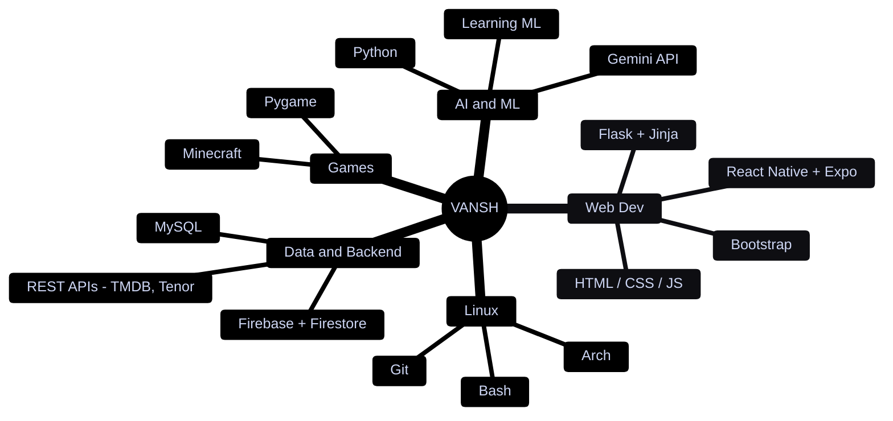
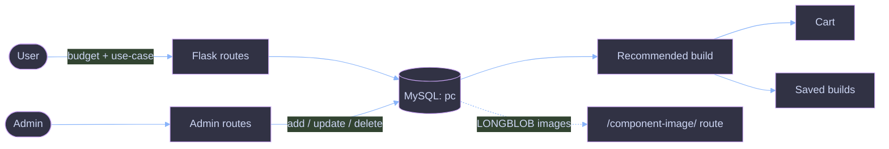
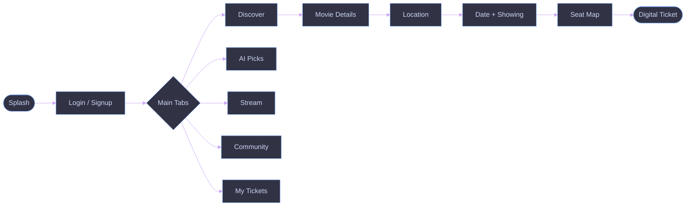
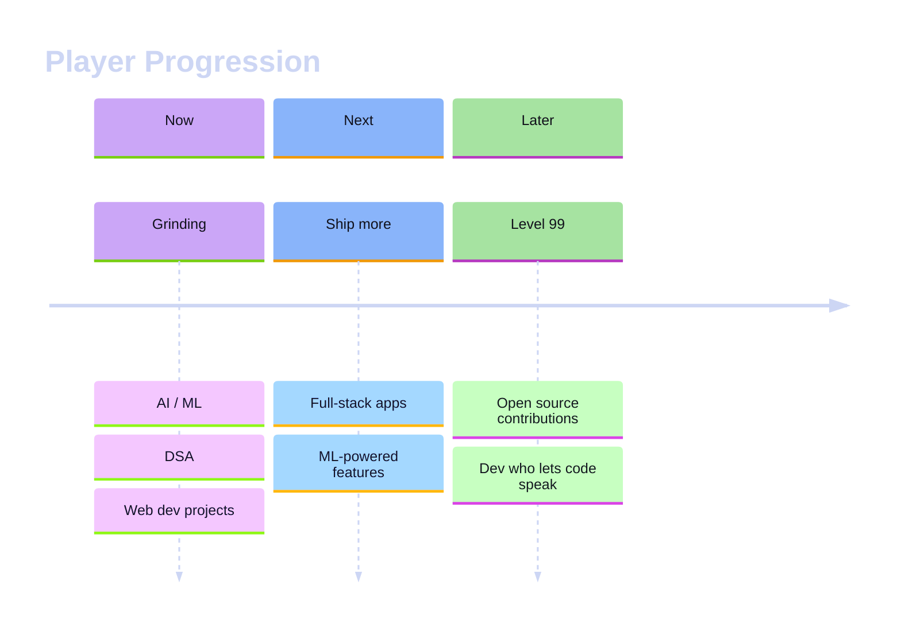

<!-- ═══════════════════════════════════════════════════════════════════
     VANSH-PROGRAMMER :: PROFILE README  v2
     theme: Hyprland rice  x  Catppuccin Mocha  x  gaming HUD
     palette: base #1e1e2e | mauve #cba6f7 | blue #89b4fa | green #a6e3a1
              pink #f5c2e7 | peach #fab387 | red #f38ba8 | text #cdd6f4
     ═══════════════════════════════════════════════════════════════════ -->

<div align="center">


<a href="https://github.com/Vansh-programmer">
  
</a>

<br/>

<!-- waybar-style workspace bar -->


</div>

<br/>

---

## 🐧 `fastfetch`

<table>
<tr>
<td width="42%" align="center">

```text
         /\
        /  \
       /    \
      /  ,,  \
     /  |  |  \
    /_-''    ''-_\

      A R C H
    i use it btw
```

</td>
<td width="58%">

```text
vansh@arch
────────────────────────────────
Name      Vansh Poonia
OS        Arch Linux x86_64
Class     B.Tech CSE (AI/ML)
Guild     Avantika University
Origin    Rajasthan -> Ujjain
Repos     22 public
Langs     Python, JS, Java, HTML/CSS
Stack     Flask, React Native, Firebase
Editor    VS Code + Terminal
Mode      always leveling up
```

</td>
</tr>
</table>

---

## ⚙️ `~/.config/vansh/profile.conf`

```ini
# ── player ──────────────────────────────────────────────
[player]
name      = Vansh Poonia
class     = Full-Stack Apprentice / ML Initiate
guild     = Avantika University, Ujjain
main_quest= become the dev who lets the code speak louder
fun_fact  = Minecraft lets you build your imagination

# ── keybinds (hyprland style) ───────────────────────────
[binds]
SUPER + RETURN    = open terminal
SUPER + C         = refill coffee
SUPER + G         = launch game (after the bug is fixed. promise.)
SUPER + SHIFT + Q = kill all bugs   # never works
SUPER + L         = lock in

# ── status ──────────────────────────────────────────────
[status]
sleep    = nerfed
coffee   = overclocked
merge_conflicts = fear
```

---

## 🌳 Skill Tree



<div align="center">

<br/><br/>
<br/><br/>


<br/><br/>


</div>

---

## 🎮 Game Library

> Each repo is a "game" in my library. Click **▶ Open save file** to peek inside.

<div align="center">

<a href="https://github.com/Vansh-programmer/Web_Recommendation">
  
</a>
<a href="https://github.com/Vansh-programmer/TicketBookApp">
  
</a>
<a href="https://github.com/Vansh-programmer/Catch-The-Book">
  
</a>

</div>

<br/>

### 🖥️ [PC Recommendation System](https://github.com/Vansh-programmer/Web_Recommendation) &nbsp;`[Strategy / Hardware Sim]`

*Tell it your budget and use-case, and it builds you a PC. Basically a loadout planner for your next rig.*


<details>
<summary><b>▶ Open save file</b></summary>

<br/>



| Feature | What it does |
|---|---|
| 🧩 **Browse components** | Explore parts by category |
| 🤖 **Build recommender** | Generates builds from budget + use-case |
| 🛒 **Cart + saved builds** | Keep the parts you like, save whole builds |
| 🛠️ **Admin panel** | Add, update and delete components |
| 🗄️ **Images in the DB** | Stored as `LONGBLOB`, served through a route |
| ⚡ **One-command start** | `./run.sh` creates the venv, installs deps, sets up the DB and launches Flask |

```text
pc_app/
├── __init__.py     # Flask app factory
├── config.py       # env settings
├── db.py           # DB connection + query helper
├── image_utils.py  # image fallback
└── routes/
    ├── public.py   # user-facing routes
    └── admin.py    # admin routes
```

</details>

<br/>

### 🎬 [TicketBookApp](https://github.com/Vansh-programmer/TicketBookApp) &nbsp;`[Mobile / Co-op / Open World]`

*A full movie ticket booking app. Browse films, pick a seat, get a digital ticket, ask Gemini what to watch, then argue about it in the community tab.*


<details>
<summary><b>▶ Open save file</b></summary>

<br/>



| Feature | What it does |
|---|---|
| 🔐 **Auth** | Email/password via Firebase Auth with session persistence |
| 🎥 **Discovery** | Now Playing, Upcoming, Top Rated, Popular and Indian Cinema via TMDB |
| 💺 **Seat selection** | Live seat map, reservations protected by Firestore transactions |
| 🎟️ **Digital tickets** | Generated after booking, all bookings in My Tickets |
| 🤖 **AI Picks** | Natural-language recommendations from Gemini, enriched with TMDB posters and ratings |
| 👥 **Community** | Posts with images, GIFs (Tenor) and voice notes, likes, comments, profanity filter |
| 🛡️ **Admin tab** | Manage the movie catalogue and showings |
| 🌊 **UI polish** | Flowing background, neon glow buttons, glass surfaces, shimmer skeletons, sound effects |

</details>

<br/>

### 📚 [Catch-The-Book](https://github.com/Vansh-programmer/Catch-The-Book) &nbsp;`[Arcade / Single Player]`

*My first game. A simple pygame arcade. Controls: **W** and **S** to move.*


<details>
<summary><b>▶ Open save file</b></summary>

<br/>

```text
┌─────────────────────────────────┐
│  W / S  ->  move the player     │
│  catch the books, dodge the lag │
│                                 │
│  while running:                 │
│      handle_input()             │
│      update()                   │
│      draw()                     │
└─────────────────────────────────┘
```

```bash
git clone https://github.com/Vansh-programmer/Catch-The-Book.git
cd Catch-The-Book
pip install pygame
python main.py
```

</details>

---

## 🏆 Achievements Unlocked

| | Achievement | Earned by |
|---|---|---|
| 💺 | **Seat Sniper** | Seat reservations guarded by Firestore transactions in *TicketBookApp* |
| 🤖 | **Prompt Whisperer** | Gemini picks enriched with TMDB posters, ratings and IMDB links |
| 🗄️ | **Blob Hoarder** | Component images stored as `LONGBLOB` in MySQL in *Web_Recommendation* |
| 🏗️ | **Architect** | Refactored Flask into an app factory plus `public` / `admin` route modules |
| ⚡ | **One-Click Deploy** | `run.sh` boots venv, deps, DB and server in one go |
| 🌊 | **Neon Everything** | Glow buttons, glass surfaces and shimmer skeletons with Reanimated |
| 🛡️ | **Chat Moderator** | Profanity filter with a local fallback in the Community tab |
| 🎮 | **Game Dev Initiate** | Shipped *Catch-The-Book* with pygame |
| 🍴 | **Forked!** | *TicketBookApp* has a fork and a pull request, with 43 commits logged |

---

## 📊 Battle Stats

<div align="center">


</div>

---

## 🗺️ Roadmap



---

## 🎖️ Trophy Room

<div align="center">


</div>

---

## 🐍 Snake Eats My Contributions

<div align="center">

<picture>
  <source media="(prefers-color-scheme: dark)" srcset="https://raw.githubusercontent.com/Vansh-programmer/Vansh-programmer/output/github-snake-dark.svg" />
  <source media="(prefers-color-scheme: light)" srcset="https://raw.githubusercontent.com/Vansh-programmer/Vansh-programmer/output/github-snake.svg" />
  
</picture>

</div>

---

## 💡 Loading Screen Tips

```text
TIP: git commit early. git commit often. git blame later.
TIP: "It works on my machine" is not a deployment strategy.
TIP: Never trust a seat map without a transaction.
TIP: Back up your dotfiles before running `pacman -Syu` at 2 AM.
TIP: Sleep is not a DLC. You cannot buy it later.
```

---

## 📡 `ping vansh`

<div align="center">

<a href="https://www.linkedin.com/in/vanshpoonia/"></a>
<a href="mailto:vanshpooniag@gmail.com"></a>
<a href="https://github.com/Vansh-programmer"></a>

</div>

```bash
$ ping vansh -c 3
64 bytes from vansh: icmp_seq=1 ttl=64 time=0.1 ms   # open to mini-projects
64 bytes from vansh: icmp_seq=2 ttl=64 time=0.1 ms   # open to collabs
64 bytes from vansh: icmp_seq=3 ttl=64 time=0.1 ms   # always down to talk tech
```

<details>
<summary><b>🕹️ ↑ ↑ ↓ ↓ ← → ← → B A</b></summary>

<br/>

```text
  ╔══════════════════════════════════════════╗
  ║   +30 LIVES   CHEAT CODE ACTIVATED       ║
  ║                                          ║
  ║   You found the secret. You and I        ║
  ║   should probably build something.       ║
  ╚══════════════════════════════════════════╝
```

</details>

<div align="center">

<br/>

```text
╔══════════════════════════════════════════════╗
║  GAME OVER?  nah.  INSERT COIN TO CONTINUE   ║
╚══════════════════════════════════════════════╝
```


</div>
